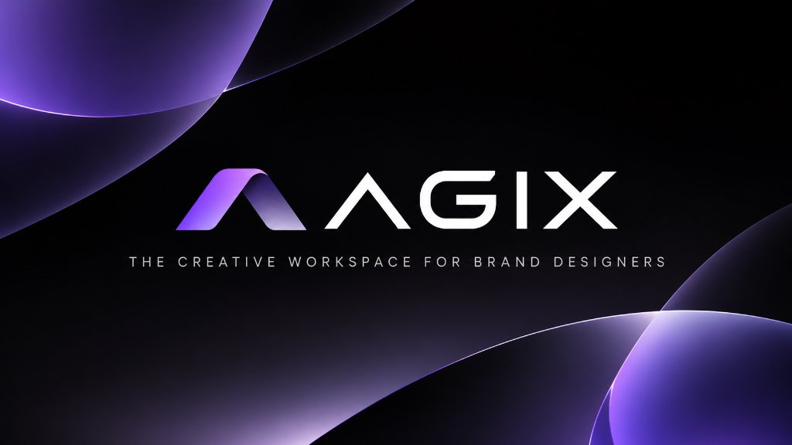

# AGIX — The Creative Workspace for Brand Designers

<div align="center">
  
  <p><strong>A unified, AI-powered creative decision-making platform for brand designers to research, explore, organize, experiment, develop brand directions, and receive client approvals.</strong></p>
</div>

## Overview

**AGIX** is not a replacement for Figma. It is the intelligent workspace that exists **before Figma** — where brand designers gather raw inspiration, extract visual DNA, query project context, battle-test competing directions, verify brand coherence, preview designs across tangible real-world mockups, and secure client sign-off.

Branding projects traditionally scatter creative decisions across dozens of disconnected tools: Pinterest boards, font foundries, color generators, client emails, messaging threads, and slide decks. AGIX unifies this entire creative decision lifecycle into a single, cohesive, design-driven operating system.

Agix connects that entire creative decision-making process into one workspace.

## 10 Core Creative Intelligence Systems

### 01 · Visual DNA Engine (`/visual-dna`)
An AI-powered visual intelligence system that analyzes multiple project references collectively.
- **Computer Vision Extraction**: Extracts observed dominant and secondary color percentages, typography rhythms, shape languages (sharp geometric vs soft organic), composition grids, visual hierarchy, and mood dynamics.
- **Explainable Grounding**: Explicitly distinguishes mathematically observed image telemetry from AI-generated creative interpretations.
- **Direction Export**: Allows designers to save generated DNA as reusable creative tokens or export them directly to the spatial canvas.

### 02 · Ask Your Board (`/ask-board`)
A context-aware conversational AI assistant connected directly to the active brand project.
- **Project Grounding**: Queries actual project references, notes, color swatches, typography specimens, and Brand Brain data.
- **Contextual Reasoning**: Answers questions like *"What colors appear most frequently in my references?"*, *"Which fonts match this brand personality?"*, and *"Find inconsistencies in my current direction"*.
- **Asset Badges**: Every response citations-links directly to saved project items and references.

### 03 · Direction Clash (`/direction-clash`)
A visual comparison environment for comparing 2 to 4 creative branding directions simultaneously.
- **Side-by-Side Analysis**: Compares color palettes, typography pairings, visual references, mood archetypes, and composition grids.
- **Audience & Positioning Compatibility**: Calculates target audience compatibility and market positioning fit scores.
- **Strategic Verdict**: Synthesizes similarities, contrasts, strengths, weaknesses, and tactical next steps, with a one-click *"Select as Primary Direction"* action.

### 04 · Brand Coherence Engine (`/brand-coherence`)
An intelligent brand consistency and alignment checker.
- **Explainable Scoring**: Calculates an overall 0–100% coherence score and letter grade based on transparent formulas (Color Harmony 30%, Typography Rhythm 25%, Imagery Consistency 25%, Positioning Alignment 20%).
- **Conflict Identification**: Detects chromatic clashes, typography hierarchy mismatches, and positioning misalignments.
- **Actionable Remediation**: Provides concrete design suggestions ranked by impact (High Impact, Medium Impact, Quick Polish).

### 05 · Reference Intelligence (`/reference-intelligence`)
Deep computer vision breakdown for individual saved references.
- **Dual Perspective**: Clearly separates objectively measured data (dominant palette percentages, aspect ratio, texture density) from AI creative recommendations (design style, mood tags, possible applications).
- **Designer Actions**: One-click actions to *Extract Color Palette*, *Add Reference to Canvas*, and *Synthesize into Visual DNA*.

### 06 · Creative Evolution Timeline (`/evolution-timeline`)
A version-controlled project history and decision tracking system.
- **Milestone Auditing**: Tracks reference additions/removals, color changes, typography iterations, and AI recommendations.
- **Decision Rationale**: Captures the *"Why"* behind creative pivots and client-requested revisions.
- **Version Recovery**: Full snapshot previews allowing designers to restore previous creative checkpoints.

### 07 · Brand in the Wild (`/brand-in-the-wild`)
An interactive brand application preview suite across 8 high-fidelity physical, digital, and environmental contexts:
1. **Website Landing Page**: Hero section with navbar, glowing brand monogram, headline, secondary copy, CTAs, and feature cards.
2. **Mobile Application**: iOS/Android frame with status bar, brand card, metrics, and navigation.
3. **Luxury Business Cards**: Front and back tactile cards with monogram, title, and contact typography.
4. **Product Packaging**: Architectural minimal box and bottle label preview with embossed brand logo.
5. **Social Media Posts**: Square Instagram and vertical Story formats with high-contrast typography.
6. **Exhibition Posters**: Large-format typographic architectural poster with coordinate markings.
7. **Presentation Slides**: 16:9 executive pitch deck slide with key impact metrics.
8. **Corporate Stationery**: A4 letterhead with brand header, watermark monogram, and envelope.
- **Real-Time Customization**: Live editable headlines, narratives, CTA copy, custom color overrides, and Dark/Light preview toggles.

### 08 · Creative Alternatives (`/creative-alternatives`)
An AI-powered stylistic exploration engine that generates distinct creative variations without overwriting original assets.
- **Preset Shifts**: *More Minimal*, *More Luxurious*, *More Experimental*, *Warmer*, *More Futuristic*, *More Editorial*, *More Professional*, or *Custom Prompt*.
- **Non-Destructive**: Compare alternatives side-by-side, save favorites to the library, or apply directly to project canvas objects.

### 09 · Creative Brief to Blueprint (`/brand-brain`)
Transforms unstructured client documents, interview transcripts, and raw notes into an architectural 12-section brand blueprint:
1. Brand Overview & Mission
2. Business Objectives & Key KPIs
3. Target Audience & Psychographics
4. Strategic Brand Positioning
5. Brand Personality & Tone of Voice
6. Core Brand Keywords
7. Competitive Landscape & White Space
8. Visual Preferences & Design Philosophy
9. Color Direction
10. Typography Direction
11. Creative Constraints & Guardrails
12. Project Deliverables Checklist
- **Provenance Badging**: Clearly labels verbatim client statements vs AI strategic interpretations.
- **Project Conversion**: In-place section editing with instant *"Sync to Project"* and *"Convert to New Project"* actions.

### 10 · Client Direction Approval (`/client-approval`)
A dedicated client presentation and sign-off portal.
- **Token-Gated Sharing**: Generate controlled, read-only review links (`/client/[token]/review`) with granular permissions.
- **Client Experience**: Clients view creative directions, compare concepts, review typography/palettes, and leave pinned comments.
- **Designer Command Center**: Monitor approval statuses (*Pending*, *In Review*, *Revisions Requested*, *Approved*), track feedback threads, review audit logs, and record verified digital signatures.

---

## Typography & Design Identity

AGIX is crafted with a bespoke typography system inspired by high-end design studios:

| Role | Font Family | Source | Characteristics |
| :--- | :--- | :--- | :--- |
| **Display & Body** | **Satoshi** | Indian Type Foundry (Fontshare) | Geometric grotesque with modern proportions, tight letter-spacing (`-0.025em`), and high aesthetic punch. Eliminates generic system/LLM fallback fonts. |
| **Editorial & Monograms** | **Instrument Serif** | Google Fonts (by Instrument NY) | High-contrast, elegant editorial serif used for monograms, classical titles, and archival accents. |
| **Technical & Metadata** | **JetBrains Mono** | Google Fonts | Crisp monospace font used for badges (`IN PROGRESS`, `IN REVIEW`), hex codes, coordinates, and specs. |

### Color & Ambience
- **Obsidian Dark Mode**: Deep black/charcoal backgrounds (`#08090E`), subtle violet/purple accents (`#8B5CF6`, `#A855F7`), electric cyan highlights (`#38BDF8`), and soft celestial star-point ambient lighting.
- **Crisp Minimal Light Mode**: Warm paper background (`#FBFBFA`), crisp ink typography (`#191918`), and refined borders.
- **Seamless Switching**: Persistent theme preference with zero-flicker client initialization.

---

## Navigation Architecture

```
WORKSPACE
├── Home                     (/home)
├── Projects                 (/projects)
├── Explore                  (/explore)
├── Library                  (/library)
├── Clients                  (/clients)
└── Brand Brain              (/brand-brain)

INTELLIGENCE
├── Visual DNA               (/visual-dna)
├── Ask Your Board           (/ask-board)
├── Reference Intelligence   (/reference-intelligence)
└── Brand Coherence          (/brand-coherence)

CREATIVE DECISIONS
├── Direction Clash          (/direction-clash)
├── Creative Alternatives    (/creative-alternatives)
└── Evolution Timeline       (/evolution-timeline)

DELIVERY
├── Brand in the Wild        (/brand-in-the-wild)
└── Client Approval          (/client-approval)

SETTINGS                     (/settings)
```

---

## Tech Stack

- **Framework**: [Next.js 15](https://nextjs.org/) (App Router)
- **UI Library**: [React 19](https://react.dev/)
- **Language**: [TypeScript 5](https://www.typescriptlang.org/)
- **Styling**: [Tailwind CSS 3.4](https://tailwindcss.com/)
- **Database / ORM**: Prisma 6 (SQLite local database) + Firebase Firestore (optional cloud sync)
- **Icons**: [Lucide React](https://lucide.dev/)
- **Web Fonts**: Fontshare (Satoshi) & Google Fonts (Instrument Serif, JetBrains Mono, Playfair Display)

---

## Getting Started

• Visual preferences

### 2. Install dependencies
```bash
npm install
```

### 3. Initialize local database
```bash
npx prisma generate
npx prisma db push
```

### 4. Run the development server
```bash
npm run dev
```

Open [http://localhost:3000](http://localhost:3000) in your browser.

### 02 · Creative Lab & Typography (`/creative-lab`)
Explore, stress-test, and compare type families using real brand context:
- Category filters: Serif, Sans, Mono, Display, Editorial, Minimal
- Multilingual specimen preview & variable font size slider
- Export integration: CSS `@font-face`, SwiftUI, UIKit, Figma, and OpenType glyph matrix

### 03 · Color Lab (`/color-lab`)
Explore and build harmonious visual color systems:
- **Interactive Harmonic Color Wheel**: Drag-and-drop color wheel with exact `#` hex codes, luminance slider, and mathematical harmony pairings:
  - Complementary (180° contrast)
  - Monochromatic (shades, tints, and tones)
  - Analogous (adjacent ±30°)
  - Triadic (120° equilateral)
  - Tetradic (90° dual-complementary)
  - Custom
- **OKLCH Spectral Lab (P3 Gamut)**: Perceptual contrast generation compliant with APCA Lc standards across 11 systematic stops (50 to 950).
- One-click copy, hex export, and direct integration into active project canvases.

### 04 · Reference Discovery (`/explore`)
A visual discovery space inspired by the way designers naturally browse inspiration:
- Unified inspiration collection without platform hopping
- Reference intelligence and automated palette/font extraction

---

## Data Flow & Architecture

The core creative data model revolves around a reusable **Creative Item**:
- `FONT`
- `COLOR`
- `PALETTE`
- `IMAGE`
- `REFERENCE`
- `TEMPLATE`
- `NOTE`
- `IDEA`

This allows external discovery sources to plug into AGIX without modifying the core library architecture.

---

## Technical Stack & Polyglot Architecture

AGIX combines specialized languages optimized for each layer of the design intelligence lifecycle:

- **Frontend & Visual Studio**: **TypeScript** (Next.js 15, React 19, Tailwind CSS, HTML5 Canvas)
- **AI & Visual DNA Services**: **Python** (FastAPI, NumPy, Pillow, Scikit-Learn K-Means quantization)
- **High-Performance Color Core**: **Rust** (OKLCH color space transforms, Display-P3 gamut clipping, APCA-W3 contrast)
- **Real-Time Collaboration Daemon**: **Go** (High-concurrency WebSocket hub, live room pooling, client review tokens)
- **Typography**: Satoshi (Fontshare), Instrument Serif, JetBrains Mono
- **Database / State**: SQLite via Prisma ORM + in-memory state sync

---

## License

Private repository created for brand designers and creative studios. All rights reserved.
